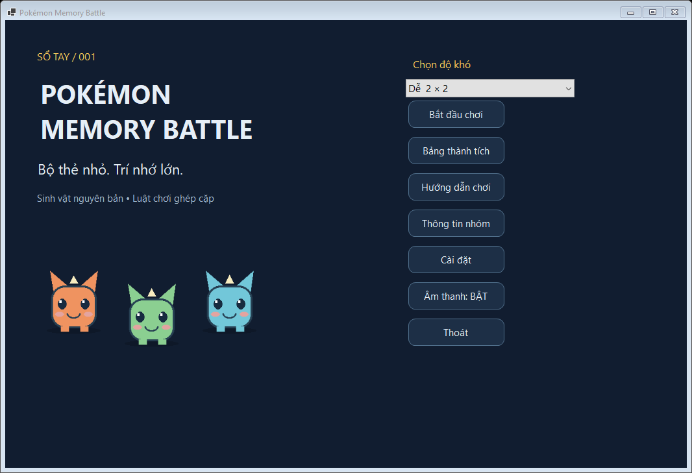
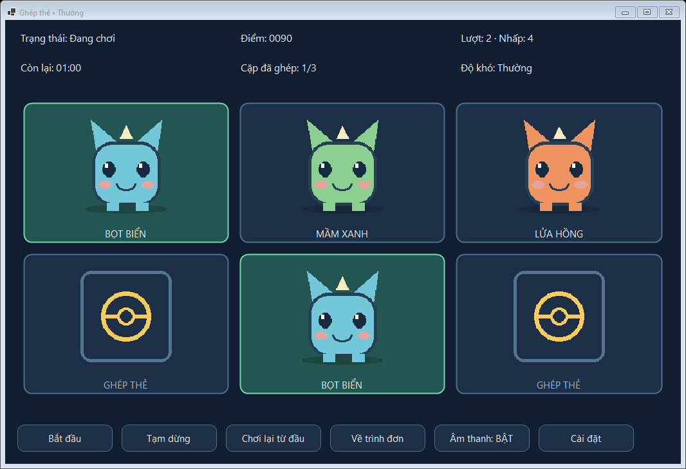
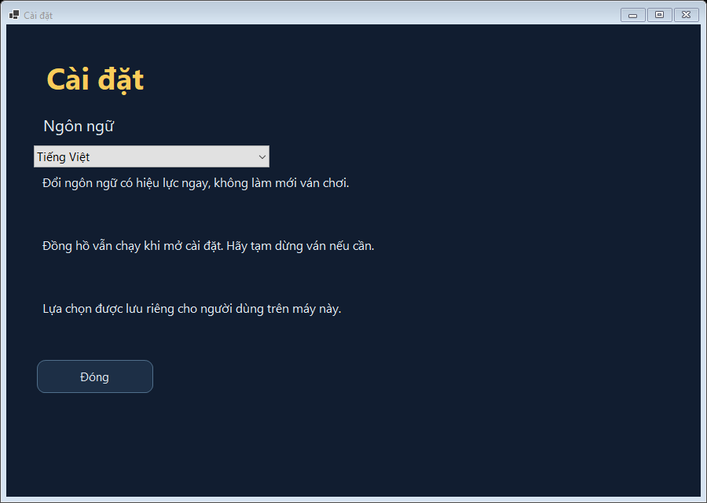
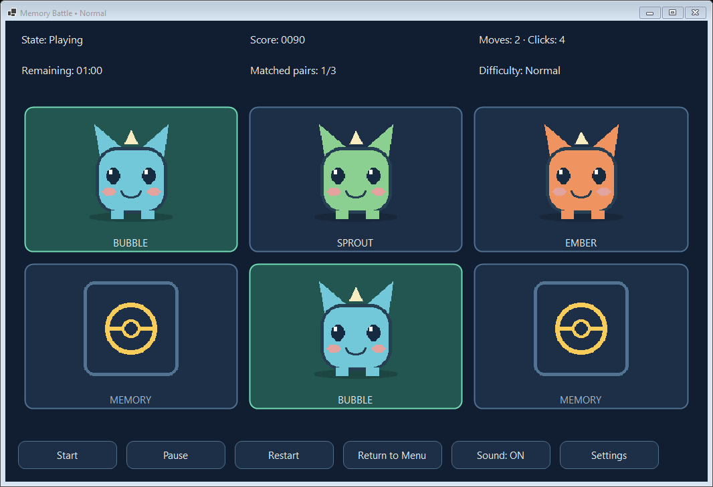

# Pokémon Memory Battle

## 1. Giới thiệu dự án
Trò chơi ghép cặp thẻ WinForms của nhóm **AltF4**, học phần **Lập trình trên Windows 2611COMP101901**, lấy cảm hứng Trúc Xanh. Sinh vật và WAV được tạo riêng; dự án không liên kết chính thức với Pokémon và không chứa tài nguyên trích từ game thương mại.

## 2. Mục tiêu đề tài
Vận dụng sự kiện, sinh điều khiển động, trạng thái, Timer, SoundPlayer, System.IO và bắt lỗi. Giao diện hỗ trợ **Tiếng Việt mặc định** và tùy chọn **English**, chuyển ngay và lưu cho lần chạy sau.

## 3. Thành viên nhóm
| STT | Họ và tên | Mã số sinh viên |
|---|---|---|
| 1 | Dương Đình Khôi | 51.01.104.049 |
| 2 | Đào Trọng Quyền | 51.01.104.085 |
| 3 | Cổ Gia Phúc | 51.01.104.126 |

## 4. Công nghệ sử dụng
Ngôn ngữ lập trình **C#**, framework **Windows Forms**, game **Pokémon Memory Battle**. Target **.NET 8 Windows** (`net8.0-windows`), Windows 10/11, Visual Studio 2022 từ 17.8 hoặc mới hơn với workload **.NET desktop development**. Đã build bằng SDK 10.0.401; `RollForward=Major` cho phép dùng Windows Desktop Runtime 10 đã cài. Bản publish tự chứa không cần cài runtime riêng.

Dùng `System.Windows.Forms.Timer`, `Stopwatch`, `SoundPlayer`, `System.IO`, `System.Text.Json`, Git/GitHub. Không dùng UI package ngoài. `LocalizationManager` quản lý hai tài nguyên JSON UTF-8 được nhúng vào assembly.

## 5. Các chức năng chính
Ba mức Dễ 2×2, Thường 2×3, Khó 4×4; Fisher–Yates; khóa hai thẻ; điểm/lượt/nhấp/cặp/đếm ngược; tạm dừng/tiếp tục; chơi lại; xác nhận thao tác; nhạc nền và phản hồi; nhập tên; bảng thành tích; hướng dẫn/nhóm; cài đặt Việt–Anh; phục hồi lỗi file/tài nguyên.

## 6. Hướng dẫn cài đặt
Cài Git, Visual Studio với workload nêu trên và .NET 8 SDK. Khôi phục targeting pack có thể cần Internet.

```powershell
git clone https://github.com/NotKioly/Pokemon-Memory-Battle-WinForms.git
cd Pokemon-Memory-Battle-WinForms
dotnet build PokemonMemoryBattle.sln -c Release
dotnet run --project src/PokemonMemoryBattle.csproj -c Release
```

Tạo bản Windows x64 tự chứa runtime:

```powershell
dotnet publish src/PokemonMemoryBattle.csproj -c Release -r win-x64 --self-contained true -o artifacts/publish
```

Chạy `artifacts/publish/PokemonMemoryBattle.exe`, giữ `img/`, `bg/`, `thanhtichs.txt` bên cạnh. Code MIT, tài nguyên gốc CC0; xem LICENSE và ASSET_LICENSE.md.

## 7. Hướng dẫn chạy dự án bằng Visual Studio
Mở `PokemonMemoryBattle.sln`, đợi restore, chọn PokemonMemoryBattle làm dự án khởi động và nhấn F5/Ctrl+F5. Các form tạo bằng C# để dễ giải thích layout/sự kiện, không có bố cục Designer sinh tự động. Build tự sao chép tài nguyên.

## 8. Hướng dẫn chơi
Chọn độ khó → Bắt đầu chơi → Bắt đầu. Dùng chuột hoặc Tab rồi phím cách chọn hai thẻ. Cặp đúng giữ mở, sai đóng sau 750ms; không chọn được thẻ thứ ba khi chờ. Tạm dừng che thẻ và giữ thời gian/delay; Tiếp tục chơi tiếp. Chơi lại từ đầu tạo bộ mới về Sẵn sàng sau xác nhận. Về trình đơn kết thúc ván. Cuối ván nhập tên 1–24 ký tự, Lưu kết quả rồi Xem thành tích.

## 9. Hướng dẫn chuyển đổi ngôn ngữ
Mở **Cài đặt → Ngôn ngữ → Tiếng Việt / English** từ menu hoặc bàn chơi. Các form đang mở, tiêu đề, thẻ, HUD, bảng điểm, hướng dẫn/nhóm, tooltip và câu hỏi xác nhận đổi ngay. Lưu tại `%LOCALAPPDATA%/PokemonMemoryBattle/settings.json`, ví dụ `{"language":"vi-VN"}`.

Lần đầu hoặc thiếu file dùng Tiếng Việt. JSON hỏng, sai kiểu, ngôn ngữ không hỗ trợ hoặc lỗi đọc cũng fallback Tiếng Việt. Không ghi được thì cảnh báo và giữ lựa chọn trong phiên. Cấu hình không nằm trong thư mục cài đặt. Đổi tiếng không reset điểm, lượt, thời gian hoặc thẻ. Đồng hồ vẫn chạy khi mở Cài đặt; hãy Tạm dừng trước nếu cần.

## 10. Hệ thống tính điểm
Đúng +100; sai −10 sàn 0; thắng +5×giây còn lại. Một lượt là hai lựa chọn hợp lệ; số nhấp đếm từng lựa chọn hợp lệ. Dễ/Thường/Khó có 45/60/120 giây. Điểm giữa độ khó không chuẩn hóa nên bảng giữ cột độ khó và kết quả.

## 11. Bảng thành tích
`thanhtichs.txt` là JSON Lines UTF-8, mỗi dòng gồm `Name`, `Score`, `Moves`, `CompletionSeconds`, `Date`, `Difficulty`, `Won`. Ngày lưu ISO 8601 theo giờ máy; giao diện định dạng theo ngôn ngữ. Sắp xếp điểm giảm dần, lượt/thời gian/ngày tăng dần. Hai dòng mẫu có tên bắt đầu Demo.

Schema và mã `Easy/Normal/Hard` giữ ổn định; chỉ hiển thị được dịch. Thiếu file tạo rỗng, dòng hỏng bị bỏ qua kèm cảnh báo. Không ghi được cạnh executable thì chuyển `%LOCALAPPDATA%/PokemonMemoryBattle/thanhtichs.txt`; nếu vẫn lỗi không báo lưu thành công. Tệp mẫu source được giữ nguyên.

## 12. Cấu trúc thư mục dự án
```text
PokemonMemoryBattle.sln
src/Program.cs
src/Forms/          # Các form, SettingsForm, LocalizedForm
src/Controls/       # Theme, MemoryCardControl
src/Models/         # Trạng thái, thẻ, độ khó, kết quả
src/GameLogic/      # GameManager, ScoreManager
src/Services/       # Ngôn ngữ, IO, ảnh, âm thanh
src/Resources/      # Strings.vi-VN.json, Strings.en-US.json
src/Utilities/      # SelfTests, LocalizationTests
img/                # 8 sinh vật
bg/                 # Mặt úp, 3 WAV
thanhtichs.txt
docs/               # Báo cáo, audit, test, kịch bản, ảnh thật
tests/Run-Tests.ps1
tools/generate_assets.py
```

## 13. Xử lý lỗi và ngoại lệ
ResourceManager, AudioManager, LeaderboardService bắt lỗi tại chỗ và phục hồi bằng ảnh vẽ, bỏ tiếng hoặc vị trí ghi an toàn. Thông báo dùng ngôn ngữ hiện hành, không chèn nguyên lỗi hệ điều hành khác ngôn ngữ. LocalizationManager ghi qua file tạm rồi đổi tên; xử lý cấu hình thiếu/hỏng/không có quyền. Cảnh báo tài nguyên dùng MessageBox.Show; hộp xác nhận có nút tự dịch. Không có catch rỗng bao trùm gameplay.

## 14. Hình ảnh giao diện
Ảnh render trực tiếp từ ứng dụng thật bằng DrawToBitmap.






## 15. Kiểm thử
```powershell
powershell -ExecutionPolicy Bypass -File tests/Run-Tests.ps1
```

Test chạy Windows, mở form thật, gọi handler và xử lý Timer Tick thật. File điểm/cài đặt test nằm trong thư mục tạm, không sửa cấu hình cá nhân. Có **62 PASS**: 43 kiểm tra gốc và 19 bổ sung, gồm đủ **LANG-01 đến LANG-15**. LANG-04 khởi chạy tiến trình mới. LANG-13 đo chữ/nút/nhãn và cửa sổ ở 100% DPI; màn hình vật lý/DPI 150–200% chưa xác minh. Xem TEST_PLAN.md, TEST_RESULTS.txt, LOCALIZATION_RESULTS.txt và FINAL_AUDIT.md trong docs.

## 16. Phân công công việc
Đây là **phân công dự kiến**, không xác nhận đóng góp thực tế từng cá nhân.

| Thành viên | Trách nhiệm dự kiến |
|---|---|
| Dương Đình Khôi | Lập trình chính, gameplay/logic, Timer/điểm, xử lý lỗi, quản lý source GitHub |
| Đào Trọng Quyền | UI/UX, tài nguyên, kiểm thử giao diện, hỗ trợ tài liệu kỹ thuật |
| Cổ Gia Phúc | Thuyết trình, minh họa game, kiểm thử/QA, chuẩn bị báo cáo cuối |
