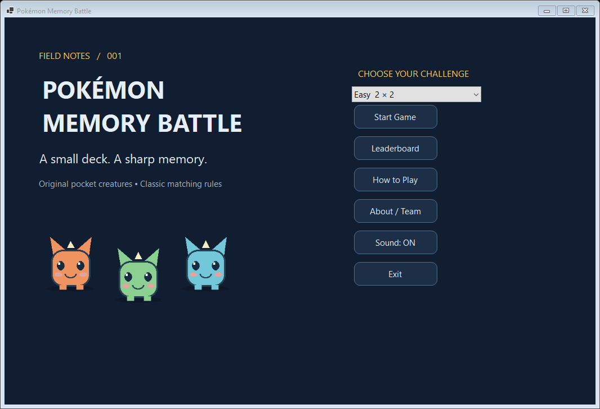
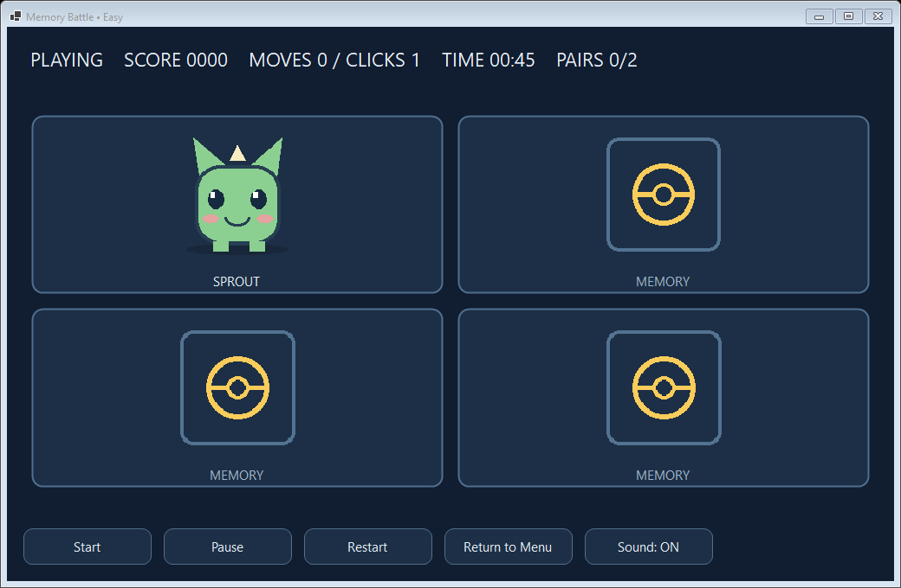

# Pokémon Memory Battle

A Windows desktop memory game for the Windows Programming midterm (2611COMP101901). Match original pocket creatures in Easy 2×2, Normal 2×3 or Hard 4×4. Includes scoring, countdown, pause, sound, player entry and a file-backed leaderboard.




## Requirements and quick start
Windows 10/11, Visual Studio 2022 17.8 or newer with **.NET desktop development**, and .NET 8 SDK/Windows Desktop Runtime. Validated using Visual Studio 2026 Community 18 and SDK 10.0.401. The target is `net8.0-windows`; `RollForward=Major` also permits the installed .NET 10 desktop runtime. No external NuGet UI packages are used. Restore downloads Microsoft targeting packs if necessary.

```powershell
git clone https://github.com/NotKioly/Pokemon-Memory-Battle-WinForms.git
cd Pokemon-Memory-Battle-WinForms
dotnet build PokemonMemoryBattle.sln -c Release
dotnet run --project src/PokemonMemoryBattle.csproj -c Release
```

In Visual Studio open `PokemonMemoryBattle.sln`, choose the PokemonMemoryBattle startup project and press F5. Forms are built in C# for straightforward code explanation; there are no generated Designer layouts to edit.

For a Windows executable without an installed runtime:

```powershell
dotnet publish src/PokemonMemoryBattle.csproj -c Release -r win-x64 --self-contained true -o artifacts/publish
```

Run `artifacts/publish/PokemonMemoryBattle.exe`. Keep `img`, `bg` and `thanhtichs.txt` beside the executable.

## Controls and scoring
Select difficulty on the menu, Start Game, then **Start** on the board. Click cards or focus with Tab and use Space. Two valid selections form one move; valid individual selections increment Clicks. Match +100, mismatch −10 (floor 0), win bonus +5 per remaining second. Countdown: 45/60/120 seconds. Pause freezes time and pending mismatch, concealing cards; Resume continues. Restart returns to Ready with a new shuffle. Return to Menu abandons the round. Sound toggles music and effects together. Win or timeout opens name entry and Save Result. Save is disabled after success to avoid duplicates.

## Persistence and resources
All packaged paths use `AppContext.BaseDirectory`. `thanhtichs.txt` uses UTF-8 JSON Lines (one `Result` per line). Fields: Name, Score, Moves, CompletionSeconds, Date (local ISO 8601), Difficulty, Won. Sample rows are labelled Demo. Sort: Score descending, Moves ascending, CompletionSeconds ascending, Date ascending. The table includes difficulty and win/loss because scores across modes are not normalized. Completion time is active whole seconds, excluding pause.

Missing file: warning and recreation. Invalid lines: warning and skip. Write/access failure: `%LOCALAPPDATA%/PokemonMemoryBattle/thanhtichs.txt`; further failures warn and preserve unsaved state. The bundled sample remains in source. Results are plain local files without tamper protection or cross-process locking.

Original generated PNG/WAV assets replace official Pokémon art and music. See `ASSET_LICENSE.md`. Code MIT; artwork/audio CC0. Pokémon trademark belongs to its owners; this is an unaffiliated educational title.

## Structure
- `src/Program.cs`: entry and test switch
- `src/Models`, `GameLogic`: state, cards, difficulty, score and matching
- `src/Forms`, `Controls`: menu, board, results, leaderboard, help, drawing
- `src/Services`: resources, SoundPlayer, System.IO
- `src/Utilities/SelfTests.cs`, `tests/Run-Tests.ps1`: executable checks
- `img`, `bg`, `thanhtichs.txt`: assignment source data copied into build and publish output
- `docs`: requirement mapping, Vietnamese report, code guide, testing and demo scripts
- `tools/generate_assets.py`: optional reproducible assets (Python + Pillow)

## Validation
Run `powershell -ExecutionPolicy Bypass -File tests/Run-Tests.ps1`. Tests open real forms and pump the WinForms message loop. They use temporary score files; bundled sample rows are preserved. See `docs/TEST_PLAN.md` and the recorded `docs/TEST_RESULTS.txt`. Release build has zero errors and warnings. Screen captures are real `DrawToBitmap` renders of running forms, not design mockups.

## Team and submission
1. Dương Đình Khôi — 51.01.104.049: gameplay, timing, storage, errors.
2. Đào Trọng Quyền — 51.01.104.085: UI, assets, report.
3. Cổ Gia Phúc — 51.01.104.126: QA, presentation, narrated video, GitHub notes.

These are proposed ownership areas for review and presentation, not claims that named students authored unperformed work. Replace placeholders in HelpForm and documentation before submission. Students must understand and rehearse the assisted implementation.

**Remaining submission tasks:** record the required 3–5 minute video with a real member narrating (script provided; no video is claimed), verify sound audibly on the presentation machine, enter this repository URL in the class sheet's **Giữa kì** column and confirm submission separately. Lecturer deadline: **27 October 2026, 23:59**, presentations **29 October 2026 from 20:00**, maximum 10 minutes, join at least 10 minutes early. Group identity/slot is unconfirmed; do not infer it from the three-member count.

## Known limitations
The Vietnamese DOCX was exported and structurally checked. Visual page QA could not run because the Windows environment has no LibreOffice or Word renderer; see `docs/DOCUMENT_QA.md`. Review it in Word before submission; `docs/REPORT.md` contains the complete report text.

Team information and narrated video require the real group. Desktop capture/input automation could read accessibility data but could not capture the live desktop window; no manual mouse-based or modal-dialog visual pass is claimed. The executable tests verify actual handlers/timers and warning callbacks. Audibility, 150%/200% DPI, dual-monitor behavior and the lecturer's computer remain manual checks. Creature flips are instant with a nonblocking 750ms mismatch display, without a 3D flip animation. The supplied WIN_T4_TrucXanh source was unavailable; comparisons refer only to limitations described in the lecturer's document.
